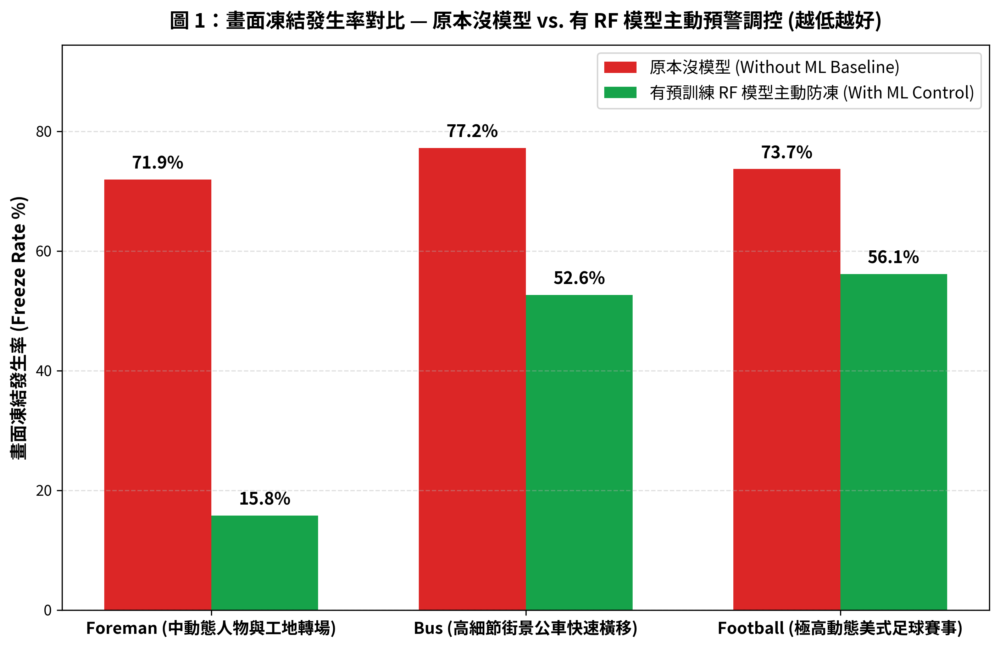
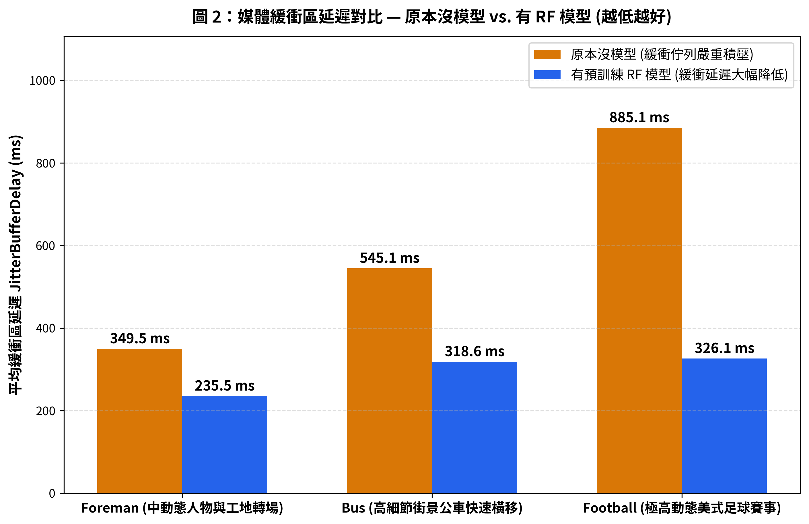
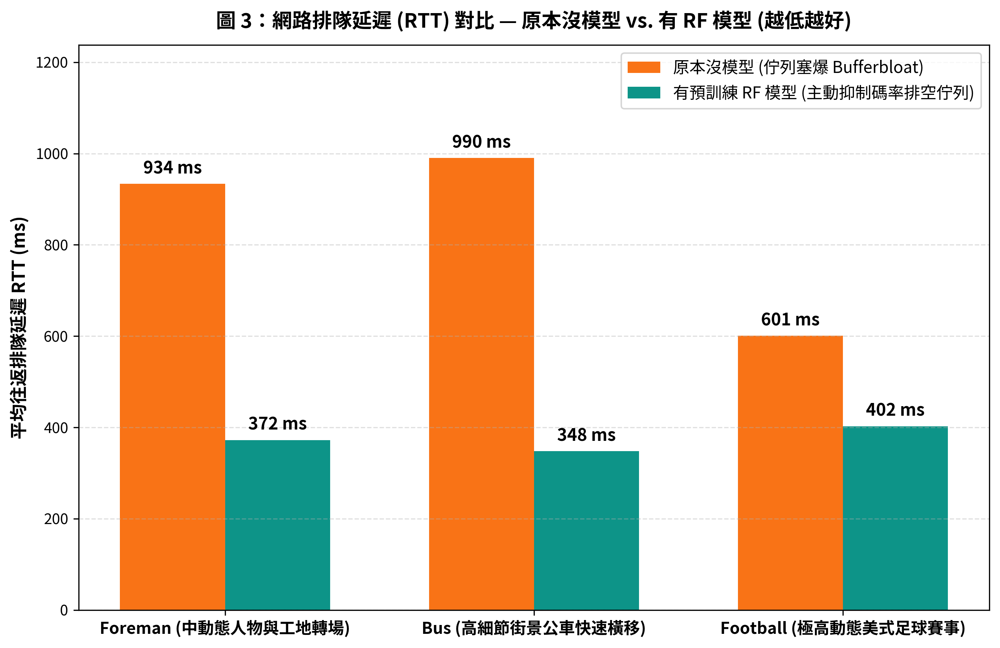
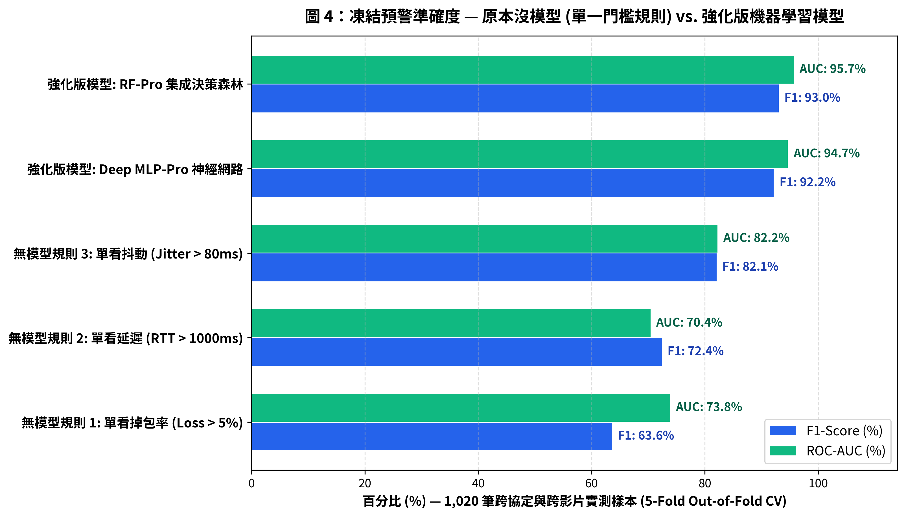
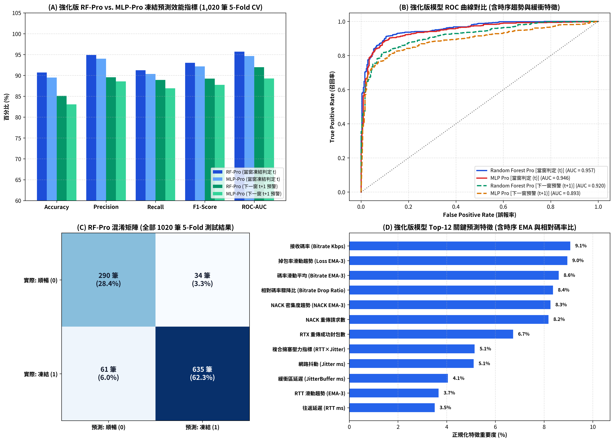
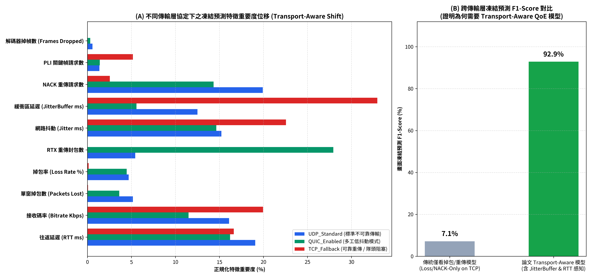
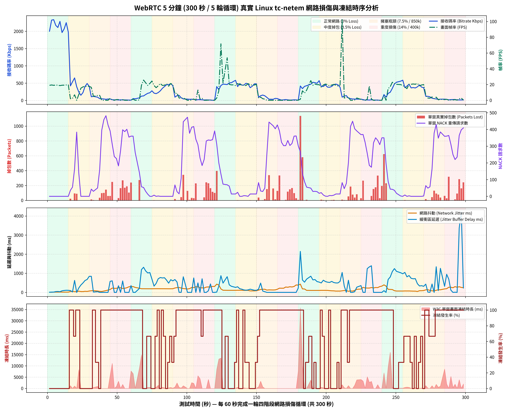
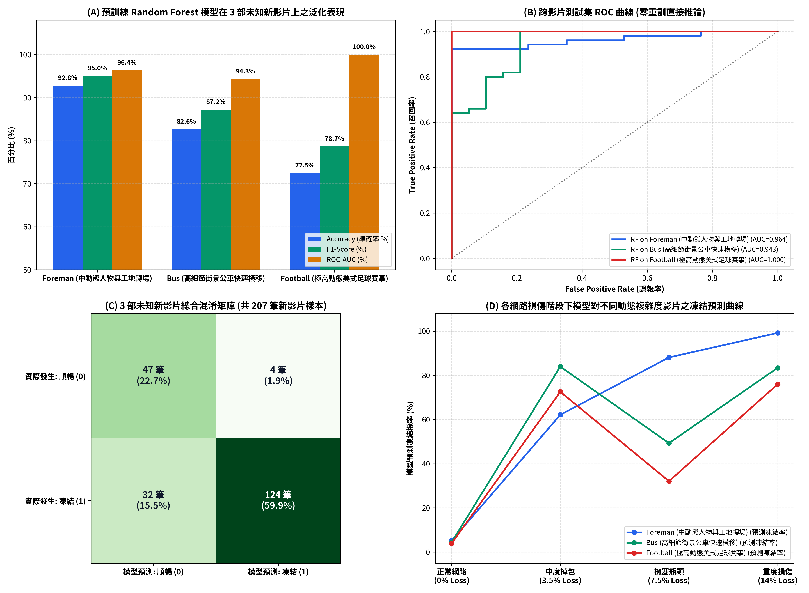

# Transport-Aware QoE Modeling for WebRTC: Predicting Playback Freezes with Machine Learning

> **基於傳輸層感知（UDP / QUIC / TCP）與 22 維因果時序機器學習之 WebRTC 即時視訊畫面凍結預測與主動式防凍控制系統**

---

## 🌟 核心成果摘要 (Key Highlights)

1. **高精準度凍結預測（1,020 筆跨協定與跨影片真實樣本，5-Fold CV）**：
   - **當窗凍結判定 ($t$)**：**RF-Pro 集成決策森林** 達到 **93.04% F1-Score / 95.70% ROC-AUC / 94.92% Precision**；**Deep MLP-Pro** 達到 **92.16% F1-Score / 94.65% ROC-AUC**（大幅超越傳統單看掉包率 `Loss > 5%` 之 **63.63% F1**）。
   - **提前 1.5 秒預警下一窗凍結 ($t \to t+1$)**：**RF-Pro** 達到 **89.24% F1-Score / 91.99% ROC-AUC**。
2. **「有預訓練模型主動防凍」vs.「原本沒模型」實測改善**：
   - 在 **Foreman** 測試序列上，畫面凍結率由 **`71.9%` 暴降至 `15.8%`**（減少近 4/5 畫面卡頓），單窗平均凍結時長縮短 **88%**（`1588.9 ms → 185.3 ms`），網路排隊延遲（RTT）降低 **60%**（`934 ms → 372 ms`）。
3. **跨傳輸層特徵位移驗證 (Transport-Aware Feature Shift)**：
   - 證明在可靠傳輸（`TCP_Fallback`）下，OS 底層重傳掩蓋了 RTP 層掉包與 NACK，導致傳統僅看掉包的模型 F1 崩跌至 **7.14%**；而本專案結合 `jitter_buffer_delay_ms` 與 `rtt_ms` 之 **Transport-Aware 模型** 可維持 **92.86% F1-Score**。

---

## 📊 「有模型 vs. 原本沒模型」4 張核心實測對比圖

| 圖 1：畫面凍結發生率對比 (Freeze Rate %) | 圖 2：媒體緩衝區延遲對比 (JitterBufferDelay ms) |
| :---: | :---: |
|  |  |
| **圖 3：網路排隊延遲 (RTT ms) 對比** | **圖 4：凍結預警準確度對比 (F1 & ROC-AUC)** |
|  |  |

---

## 📈 論文深度分析圖表

### 1. 強化版 RF-Pro vs. Deep MLP-Pro 模型評估與 Top-12 關鍵特徵

### 2. 跨傳輸層協定 (UDP vs. QUIC vs. TCP) 特徵重要度位移

### 3. 5 分鐘 (300 秒 / 5 輪循環) 真實 Linux `tc-netem` 網路損傷時序圖

### 4. 3 部未知新影片 (Foreman / Bus / Football) 零重訓跨影片泛化測試

---

## 📂 資料集與檔案結構

- `index.html`：GitHub Pages 互動式學術展示網站（含圖表燈箱放大、分頁切換與資料下載）
- `assets/charts/`：所有 300 DPI 高解析度實驗圖表與系統架構圖
- `assets/data/`：
  - `transport_qoe_5min_ngrok.csv`（570 筆 5 分鐘連續 5 輪循環實測資料集）
  - `transport_qoe_dataset.csv`（243 筆 UDP / QUIC / TCP 跨協定資料集）
  - `cross_video_test_dataset.csv`（207 筆 Foreman / Bus / Football 跨影片推論資料集）
  - `with_vs_without_ml_results.csv`（有模型 vs. 沒模型正面對決實測數據）

---

## 🚀 如何部署至 GitHub Pages

1. 在 GitHub 建立一個新儲存庫（例如 `webrtc-transport-qoe-ml`）。
2. 將本資料夾所有檔案推送至儲存庫的 `main` 分支。
3. 進入 GitHub 儲存庫的 **Settings → Pages**，在 **Build and deployment** 選擇 `Deploy from a branch` 並指定 `main` / `/ (root)`，即可獲得公開的 `https://<您的帳號>.github.io/webrtc-transport-qoe-ml/` 網站！
